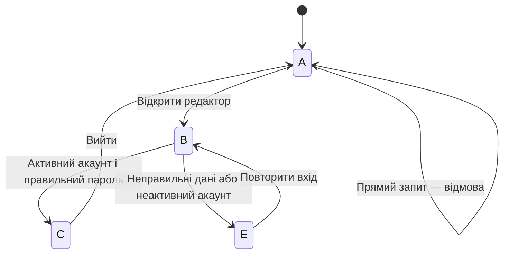

# S-01 — навчальна симуляція входу редактора

Фактичний початок роботи в спринті 2: 2026-10-27. Статус на 2026-10-30: прийнята навчальна модель; Done після звірки з трекером.
Історичний початок деталізації S-01: 2026-10-12; дата завершення навчальної історії: 2026-10-30.

## Формат і межі
За уточненням студента від 26 жовтня результат — модель поведінки та протокол її проходження, без розробки CMS. Це не доказ роботи реального сайту чи серверного захисту. Ролі редактора й перевіряльника навчальні; зовнішнього приймальника не вигадуємо.

## Модель для опрацювання
Стани: A — неавторизований; B — форма входу; C — редакторський розділ; E — загальна помилка.
Умовний активний акаунт EDITOR-A; PASSWORD-OK і PASSWORD-WRONG — лише позначки тестових даних, не справжні паролі.
A → B при спробі відкрити редактор. B → C за правильних даних активного акаунта.
B → E при неправильному паролі чи невідомому акаунті; повідомлення однакове: «Не вдалося увійти».
C → A після виходу. Прямий запит без авторизованого стану → відмова, без видачі захищених даних.

## План проходження
| Перевірка | Вхідні дані / дія | Очікувана поведінка моделі | Фактичний результат |
| --- | --- | --- | --- |
| T1 | EDITOR-A + PASSWORD-OK | Перехід B → C | 2026-10-28: PASS, A → B → C; запит моделі повернув 200 |
| T2 | EDITOR-A + PASSWORD-WRONG | Перехід B → E | 2026-10-28: PASS, E; захищений вміст недоступний |
| T3 | Невідомий акаунт | Те саме повідомлення E, що T2 | 2026-10-28: PASS, виходи T2 і T3 однакові |
| T4 | Прямий запит зі стану A | Відмова, захищені дані не показані | 2026-10-28: PASS, умовний статус 403 і порожній вміст |
| T5 | Вийти з C та знову відкрити редактор | A → B, повторний вхід потрібен | 2026-10-28: PASS, C → A → B; прямий запит після виходу відхилено |

## Критерій завершення навчальної роботи
Є схема/ескіз усіх станів, датований протокол T1–T5 з фактичними переходами, зауваження й повторні перевірки за потреби; кожен продуктовий критерій S-01 зіставлений із перевіркою моделі. Позначка завершення стосується тільки симуляції, а не реалізованої функції.

## Готовність перед набором — 27 жовтня
Цінність та SC-02 взято з backlog.csv; усі чотири критерії зіставлено з T1, T2/T3, T4, T5. Джерела та цей файл доступні. Зовнішні доступи не потрібні. Сценарій, дані й спосіб перевірки визначено до набору. На момент набору оцінки SP були відкладені до ЛР8; 28 жовтня звірено S-01=3 SP за estimates.csv.

## Фактично зроблено 27 жовтня
Уточнено формат результату, створено початкову модель і план проходження. Наступна робота — ескіз станів та виконання T1–T5. Протокол приймання не підмінено очікуваннями.

## Ескіз станів — 28 жовтня



| Стан | Видимий зміст екрана | Доступна дія |
| --- | --- | --- |
| A | Публічна сторінка, редакторський вміст відсутній | Відкрити редактор |
| B | Поля «Акаунт», «Пароль», кнопка «Увійти» | Надіслати введені дані |
| C | Заголовок «Редакторський розділ», кнопка «Вийти» | Переглянути розділ або вийти |
| E | Загальне повідомлення «Не вдалося увійти» | Повторити спробу через форму B |

## Датований протокол виконання — 2026-10-28

Виконавець перевірки — асистент у межах навчальної симуляції, без участі зовнішнього приймальника. Запущено `python lr03_sprint_simulation/sprint2/check_s01.py` з кореня репозиторію. Файл містить виконувану модель станів і окремі перевірки умов; 200/403 — умовні відповіді моделі, не HTTP-запити до сайту.

Фактичний вивід запуску:

```text
S-01 EDUCATIONAL MODEL ONLY
T1 PASS: A -> B -> C; authorized model request=200
T2 PASS: B -> E; no protected model content
T3 PASS: unknown account and wrong password have identical output
T4 PASS: unauthenticated direct request=403; empty content
T5 PASS: C -> A -> B; direct request after logout=403
T6 PASS: inactive account cannot authorize
T7 PASS: E -> B -> C on retry with valid model data
```

Зіставлення з чотирма критеріями S-01 у backlog.csv: активний власний акаунт і розділ — T1/T6; загальна помилка без розкриття акаунта — T2/T3; відхилення неавторизованого прямого запиту — T4; недоступність після виходу — T5. Додатково T7 перевіряє повернення після помилки.

Під час уточнення ескізу додано явний шлях повторної спроби E → B і відмову неактивному акаунту. Розбіжностей під час виконаного прогону не виявлено. Це перевірка внутрішньої узгодженості моделі, а не незалежний аудит безпеки чи доказ роботи CMS.

Результат передано в локальний стан Ready for review: ескіз і T1–T5 готові, але окреме приймання не відбулося, дату Done і завершені SP не встановлюємо. Дошку GitHub під час цієї роботи не змінювали; статус тут описує готовність артефакту до огляду. Наступний крок — огляд моделі й протоколу за критеріями; огляд та ретроспектива всього спринта лишаються запланованими на 9 листопада.

Дія ретроспективи: перевірені до набору сценарії й тестові дані використано в реальному запуску моделі. Це проміжний доказ користі підготовки; остаточний висновок для всього спринта робиться на ретроспективі. Нових зовнішніх блокерів та подій досягнення WIP-ліміту не зафіксовано.

## Окремий огляд — 2026-10-30

Асистент повторно переглянув артефакт від 28 жовтня через два календарні дні після його підготовки. Це відкладена самоперевірка за DoD, не приймання викладачем або кафедрою. Додано [desktop/mobile ескізи](S-01-wireframes.md), які відображають ті самі стани без зміни моделі. Запуск `python lr03_sprint_simulation/sprint2/check_s01.py` 30 жовтня: T1–T7 — PASS, код завершення 0; модель `check_s01.py` із коміту aefa15d не змінювалася.

| Критерій S-01 | Доказ | Рішення |
| --- | --- | --- |
| Вхід активного редактора власним акаунтом | T1, T6, стани B/C | Пройдено в моделі |
| Загальна помилка без розкриття акаунта | T2/T3, однаковий E | Пройдено в моделі |
| Відмова неавторизованому запиту | T4, умовні 403 і порожній вміст | Пройдено в моделі |
| Недоступність після виходу | T5, C→A→B | Пройдено в моделі |

DoD: 1 — схема й ескізи доступні; 2 — усі чотири критерії зіставлені вище; 3 — датовані прогони 28 і 30 жовтня, 7/7 PASS; 4 — розбіжностей з базовими критеріями немає, обмеження названі; 5 — окремий огляд моделі 28 жовтня проведено 30 жовтня; 6 — обидва текстові ескізи перевірені за переліком дій; 7 — дата 30 жовтня, 3 SP один раз у спринті 2, джерела в журналі й issue #13.

Рішення огляду: прийняти S-01 як завершений навчальний артефакт за початковими критеріями. Академічний SSO, журнал доступу і сторінка зберігання даних з CH-01 не реалізовані; рішення за ними deferred. Тому Done цієї базової історії не означає готовність безпекових вимог або можливість експлуатації сайту. Невиконані S-03/S-04 не зараховані. Відкритих дефектів моделі за перевіреними критеріями немає; реальний захист сервера не перевірявся.
