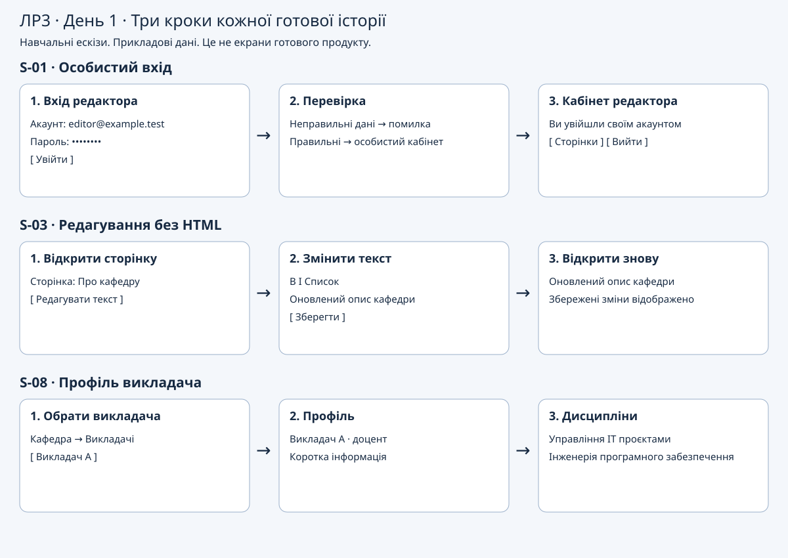
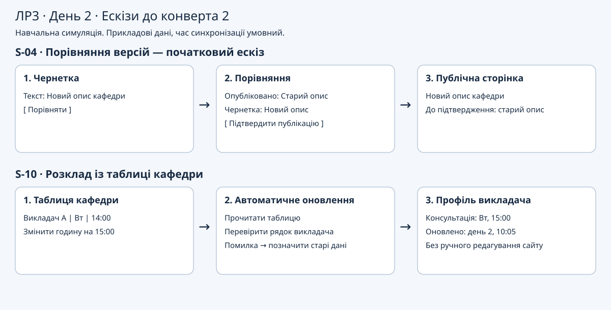
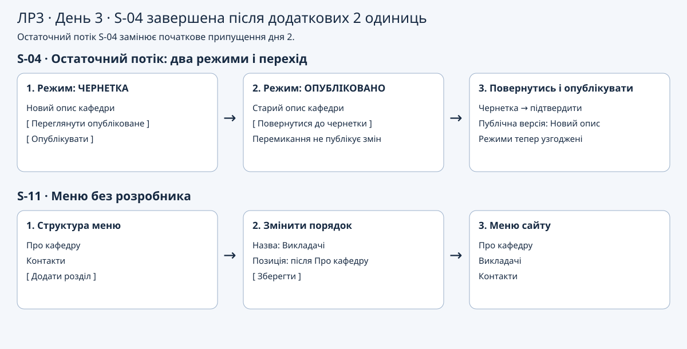

# Журнал спринта, ЛР3

| Поле | Значення |
| --- | --- |
| Студент і підгрупа | Фесюк Сергій, КН-42 |
| Тема і файл стартового беклогу | Сайт кафедри; `lr03_backlogs/department_site.csv`, усі 13 історій S-01–S-13 |
| Дати роботи | 2026-10-11; дні 1–3 є умовними днями симуляції |

Джерела: `lr03_task.md`, стартовий беклог теми, `lr03_envelopes.md` і слайд 10 `L3_presentation.html` з архіву курсу від 09.10.2026. Це навчальна симуляція рішень і прототипів, не звіт про розроблений сайт чи реальні спринти. Перевірки нижче — сценарії приймання ескізів, не результати тестування продукту.

## 1. Порядок беклогу і цінність

Роль: Product Owner. Початковий порядок: S-10, S-08, S-09, S-03, S-04, S-01, S-11, S-02, S-06, S-07, S-05, S-12, S-13.

| story_id | Чому вгорі, словами замовника |
| :-: | --- |
| S-10 | Години консультацій мають підтягуватися з таблиці кафедри: ніхто не дублюватиме їх щотижня на сайті. |
| S-08 | Студент має відразу знайти викладача та його дисципліни. |
| S-09 | Наявні сторінки треба перенести зі старого сайту без повторного набору. |
| S-03 | Працівник має сам виправляти інформацію, не чекаючи розробника. |
| S-04 | Перед публікацією потрібно бачити різницю між чернеткою і публічною сторінкою, щоб не оприлюднити помилку. |

## 2. Ціль спринта

**Ціль одним реченням:** наприкінці спринта відвідувач може відкрити сторінку викладача та за один погляд знайти актуальний час консультації, який автоматично надходить із таблиці кафедри.

**Чому вона цінна для замовника:** студент не уточнює години в чаті, кафедра змінює їх лише в одному джерелі.

**Як перевірю, що досягнута:** пройти на ескізах шлях «сторінка викладача → консультації», змоделювати зміну години в таблиці та її появу без ручного редагування сайту. Для «так» S-08 і S-10 мають бути готові за правилами симуляції; статичний напис із годинами не замінює S-10.

## 3. Оцінки і спринт-беклог

Роль: Developer. Ємність — 12 одиниць, максимум 4 на день. Оцінки: 1 — проста, 2 — середня, 3 — велика історія. Це одиниці симуляції, не story points V10 або ЛР8.

| story_id | Назва | Оцінка | Узято в спринт | Причина вибору або відмови |
| :-: | --- | :-: | :-: | --- |
| S-01 | Вхід редактора кафедри | 1 | так | Особистий доступ до редагування. |
| S-02 | Хто публікує і хто готує чернетку | 2 | ні | У прототипі один уповноважений редактор; розподіл ролей поза ціллю. |
| S-03 | Редагування сторінки без знання HTML | 2 | так | Працівник сам підтримує текст сторінок. |
| S-04 | Чернетка і опублікована версія | 2 | так | Контроль змін перед публікацією. |
| S-05 | Новина з фотографією | 2 | ні | Новини не потрібні для пошуку консультації. |
| S-06 | Список публікацій викладача | 2 | ні | Пошук наукових робіт — інший сценарій. |
| S-07 | Файл до публікації | 1 | ні | Залежить від відкладеного сценарію публікацій. |
| S-08 | Сторінка викладача | 1 | так | Точка входу до консультацій; підтримує ціль. |
| S-09 | Перенесення сторінок зі старого сайту академії | 3 | так | Збереження наявного контенту без повторного набору. |
| S-10 | Розклад консультацій із таблиці кафедри | 2 | так | Автоматичне оновлення; підтримує ціль. |
| S-11 | Редагування меню сайту | 1 | так | Корисно кафедрі; також заповнює останню одиницю дня 2 — це рішення перегляну в ретроспективі. |
| S-12 | Історія змін і відкат | 3 | ні | Повний журнал і відкат не вміщаються у спринт. |
| S-13 | Звіт відвідуваності сторінок | 2 | ні | Аналітика потрібна після появи використання. |

**Сума оцінок узятого:** 1 + 2 + 2 + 1 + 3 + 2 + 1 = **12**.

Початковий розклад: день 1 — S-01 + S-03 + S-08 = 4; день 2 — S-09 + S-11 = 4; день 3 — S-04 + S-10 = 4. Набір зафіксовано до конвертів; зміни далі записуються явно, початкові оцінки не переписуються.

Означення готовності: ескіз екрана або три кроки потоку + рядок перевірки користувачем + день завершення. Незакінчені історії не зараховуються частково.

## 4. День 1

| story_id | Одиниць | Як користувач перевірить | Ескіз | День завершення |
| :-: | :-: | --- | --- | :-: |
| S-01 | 1 | Редактор вводить власні дані й потрапляє у кабінет; неправильні дані залишають його на вході. | [Вхід](sketches/day1.svg) | 1 |
| S-03 | 2 | Редактор змінює текст без HTML, зберігає і після повторного відкриття бачить зміни. | [Редактор](sketches/day1.svg) | 1 |
| S-08 | 1 | Відвідувач обирає викладача та бачить профіль і перелік дисциплін. | [Профіль](sketches/day1.svg) | 1 |

Разом **4 одиниці**. S-03 моделює збереження тексту, порівняння версій залишається S-04. Профіль S-08 не означає готовності автоматичного розкладу S-10.

**План на день 2, записаний до відкриття конверта 1:** S-09 (3) — перенести сторінки, потім S-11 (1) — налаштувати меню; разом 4.

**Після конверта 1:** S-09 була в початковому наборі (3 одиниці), але відповідь власників старого сайту надійде не раніше наступного тижня. Переношу S-09 у заблоковані до кінця спринта, готовою не позначаю. Звільнені 3 одиниці лишаю резервом, нових історій не додаю. На день 2 переміщую S-04 і S-10 з дня 3, щоб раніше перевірити основний сценарій; S-11 переношу на день 3.

Універсальний текст конверта називає S-09 єдиною історією другої вимоги замовника. У беклозі саме нашої теми S-09 — **міграція старих сторінок**, а регулярне автоматичне оновлення консультацій — **S-10**. Ідентифікатори не підмінюю: заборона закрити S-09 діє, але для демонстраційної сторінки викладача S-08 використовую явно прикладові дані. Міграцію не імітую ручним перенесенням і не оголошую виконаною. Ціль щодо S-08 + S-10 поки залишається досяжною.

## 5. День 2

| story_id | Одиниць | Як користувач перевірить | Ескіз | День завершення |
| :-: | :-: | --- | --- | :-: |
| S-04 | 2 | Редактор порівнює чернетку і публічну версію, бачить змінений рядок, публікує; до підтвердження публічна версія лишається старою. | [Порівняння версій](sketches/day2.svg) | 2, до перегляду після конверта 2 |
| S-10 | 2 | Після зміни години у таблиці кафедри наступне оновлення показує її на профілі без редагування сайту; видно час синхронізації. | [Автоматичний розклад](sketches/day2.svg) | 2 |

Використано **4 одиниці**. У сценарії S-10 помилка синхронізації показує попередні дані з попередженням, а не видає їх за актуальні. Доступна навчальна таблиця — припущення симуляції; реальне підключення тут не виконувалось.

**План на день 3, записаний до відкриття конверта 2:** завершити S-11 (1 одиниця), залишити 3 одиниці резерву через блокування S-09. Огляд має перевірити профіль і оновлення консультацій за ціллю, а не кількість закритих історій.

**Після конверта 2:** S-04 повертається в роботу. Її оцінка зростає з 2 до **4**: 2 витрачено на день 2, ще 2 потрібні на день 3. Статус «готово» дня 2 скасовано; часткового зарахування немає. Початкове порівняння не замінює два окремі режими перегляду та явні переходи між ними.

Додаткові 2 одиниці беру з резерву 3, який утворився після блокування S-09. S-11 залишається в плані дня 3 (1), невикористаний резерв — 1. Жодної нової історії не додаю; S-09 лишається незавершеною через зовнішню залежність, а не через подорожчання S-04. На плануванні варто було намалювати окремо «перегляд чернетки», «перегляд опублікованої версії» і переходи, а не оцінювати їх як один екран.

## 6. День 3 і рішення за конвертом 3

| story_id | Одиниць цього дня | Як користувач перевірить | Ескіз | День завершення |
| :-: | :-: | --- | --- | :-: |
| S-04 | 2 додаткові; разом 4 | Редактор перемикає два режими: чернетка містить новий текст, опублікована версія — старий; повертається до чернетки, підтверджує публікацію і лише тоді бачить новий текст публічно. | [Два режими та переходи](sketches/day3.svg) | 3 |
| S-11 | 1 | Редактор додає розділ «Викладачі», змінює його місце, зберігає і бачить цей порядок у меню сайту. | [Редагування меню](sketches/day3.svg) | 3 |

Використано **3 одиниці** дня 3; 1 одиниця не використана. Перед конвертом 3 підсумок витрат: 4 + 4 + 3 = **11**, денний максимум 4 дотримано. S-04 зараховується готовою лише тепер і лише один раз, з повною уточненою оцінкою 4.

**Рішення за конвертом 3 і його ціна:** не беру додаткову S-05 «Новина з фотографією» для ефектного демо. Вона не потрібна для цілі про консультації, коштує 2 одиниці, а спринт уже завершився. Навіть невикористана одиниця ємності не створює часу після завершення дня. Ціна відмови — на цьому огляді замовник не побачить новини з фото; повертаємо цю потребу до обговорення пріоритетів наступного спринта. Готові історії не знімаю, заднім числом роботу не додаю.

**Що б я сказав замовнику вголос:** «Сьогодні покажу, як студент знаходить викладача та актуальні консультації без ручного дублювання годин. Новину з фото не встигнемо якісно підготувати до цього огляду. Запишемо її в беклог і обговоримо пріоритет наступного спринта; обіцяти її готовність зараз було б неправдою».

## 7. Огляд

Готові історії за означенням готовності симуляції:

| story_id | Початкова оцінка | Уточнена оцінка | День готовності | Доказ |
| :-: | :-: | :-: | :-: | --- |
| S-01 | 1 | 1 | 1 | Рядок перевірки у розділі 4; `sketches/day1.svg`, вхід. |
| S-03 | 2 | 2 | 1 | Рядок перевірки у розділі 4; `sketches/day1.svg`, редактор. |
| S-08 | 1 | 1 | 1 | Рядок перевірки у розділі 4; `sketches/day1.svg`, профіль. |
| S-10 | 2 | 2 | 2 | Рядок перевірки у розділі 5; `sketches/day2.svg`, джерело → синхронізація → профіль. |
| S-04 | 2 | 4 | 3 | Рядок перевірки у розділі 6; `sketches/day3.svg`, обидва режими. |
| S-11 | 1 | 1 | 3 | Рядок перевірки у розділі 6; `sketches/day3.svg`, меню. |

**Ціль спринта досягнута: так.** У межах означення готовності симуляції S-08 і S-10 мають повні потоки, перевірки та дні завершення. Показую профіль і сценарій зміни 14:00 → 15:00 через таблицю, без ручної зміни сайту. Це приймання навчального прототипу, не твердження про працездатну інтеграцію у реальному сайті.

**Якщо ні, то через що саме:** не застосовується. Водночас увесь початковий обсяг не завершено: **S-09 заблокована**, 0 одиниць зараховано, повертається у продуктовий беклог до отримання доступу. Ціль була вужчою за повну міграцію сайту.

Шість завершених історій: 9 одиниць за початковими оцінками, **11 за уточненими**. Облік витрат: день 1 — 4, день 2 — 4 (включно з 2 на ще не завершену після конверта S-04), день 3 — 3. Початкова ємність 12; 12 − 3 заблокованої S-09 + 2 уточнення S-04 = 11, резерв 1. Незавершену S-04 на день 2 у готовий результат не включаю.

## 8. Блокери

Роль: Scrum Master. Тут записано події сценарію, а не фактичне листування з адміністрацією академії.

| Коли | Що зупинило роботу | Чим закінчилось |
| :-: | --- | --- |
| Кінець дня 1, конверт 1 | S-09: потрібні дані/доступ від власників старого сайту; відповідь не раніше наступного тижня. | Блокер не знято до кінця дня 3. S-09 не виконана, повернена в беклог; 3 одиниці звільнено. Наступна дія — отримати доступ і перевірити зразок сторінки перед повторним набором. |

S-04 — **помилка оцінки**, а не зовнішній блокер: на неї можна було працювати. Повернуто в роботу після дня 2, додано 2 одиниці, завершено на день 3. Прохання з конверта 3 — зміна обсягу, відхилена для поточного спринта; роботу воно не зупинило.

## 9. Ретроспектива

**Що допомагало:** одна перевірювана ціль, денний ліміт і явний резерв після блокування; вони дозволили доробити S-04 без понаднормових одиниць. Плани записані до конвертів, тому видно справжню зміну рішення.

**Що заважало:** S-09 взято без підтвердженого доступу, два режими S-04 оцінено як один екран. Додатково я намагався заповнити всі 12 одиниць: S-11 потрапила в набір частково через те, що була дешевою, хоча для перевірки цілі достатньо прямого переходу на профіль.

**Одне рішення на наступний спринт:** перед набором застосувати до кожної кандидатної історії коротку перевірку готовності до планування: записати зв'язок із ціллю, намалювати всі режими/переходи та підтвердити доступність зовнішніх даних; історію з неперевіреною залежністю або без зв'язку з ціллю не брати лише заради завантаження.

**Як перевірю, що це сталося:** до завершення наступного Planning кожна взята історія має ці три позначки з доказом (для відсутньої зовнішньої залежності — «не потрібна»). Критерій — 100% узятих історій перевірено, 0 історій узято з непідтвердженим доступом; S-09 можна повернути лише після перевірки зразка старої сторінки. Наприкінці наступного спринта перевірити дотримання правила за записами, а не за обіцянкою.

**Перша картка для ЛР4:** «Перевірити готовність кандидатних історій перед набором спринта». Результат картки — заповнений список із трьома перевірками та посиланнями на докази для кожної взятої історії. Це вихід ретроспективи; саму дошку ЛР4 у цій роботі ще не створено.

## 10. Самодіагностика «Scrum, але»

**Спотворення зі слайда 10 L3:** Sprint Goal перетворюють на «мішок незв'язаних тікетів, щоб усі були зайняті».

**Ознака в цьому журналі:** ціль у розділі 2 зв'язна, але набір у розділі 3 частково наслідує це спотворення: S-11 узято також для заповнення останньої одиниці дня 2. Власне редагування меню не потрібне, щоб відкрити профіль прямим переходом і побачити консультації. Отже число 12 стало додатковою неявною ціллю планування. На огляді не підмінюю користувацький результат кількістю історій; на наступному Planning застосую перевірку з розділу 9.
